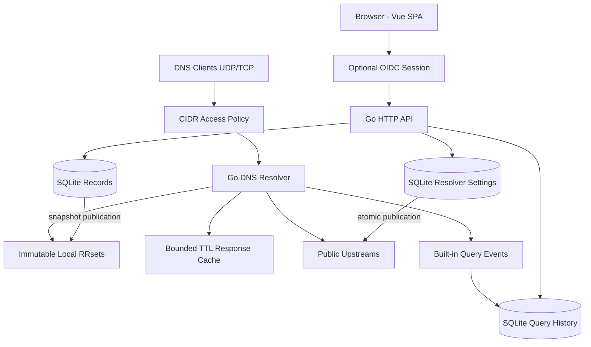

# QuillDNS architecture

QuillDNS is a Go-native DNS override proxy with an embedded Vue 3 control plane, a dedicated API, and first-party observability. It requires no Redis, PostgreSQL, Prometheus, Grafana or separate Node server at runtime.

## Topology

## Bounded contexts

| Context | Package | Responsibility |
|---|---|---|
| Record management | `internal/records` | Canonicalization, record invariants, SQLite transactions, immutable snapshots |
| Resolution | `internal/dnsserver` | UDP/TCP DNS, local-first lookup, positive caching, upstream fallback and client policy |
| Resolver settings | `internal/settings` | Validated ordered upstreams, durable settings |
| Observability | `internal/observability` | Bounded in-memory counters, nonblocking asynchronous SQLite query history |
| Management API | `internal/httpapi` | Versioned request/response protocol, orchestration |
| Authentication | `internal/auth` | OIDC Code + PKCE, ID token validation and short-lived browser sessions |
| Frontend | `web/src/features` | View-specific Vue components, Pinia Colada server state and Nuxt UI |
| Embedded UI | `webassets` | Static file embedding into the Go executable with `go:embed` |

## DNS query contract

1. Validate client CIDR and DNS question. Reject unauthorized clients with REFUSED.
2. Look for a matching locally defined RRset by fully qualified name and type. CNAME is an alias override and conflicts with other types at the same name.
3. If no local match, consult the bounded positive cache, unless EDNS or DNSSEC-sensitive options require bypass.
4. Forward to upstream resolvers in order, retrying truncated UDP replies over TCP.
5. Emit bounded in-memory telemetry and asynchronous history with no SQL writes on the DNS hot path.

**Split-horizon override semantics:** A local A override for `api.example.com` does not block a public TXT query for that same hostname. This is different from an authoritative DNS zone; it is a purposeful user-facing product policy.

## Management lifecycle

Record writes validate the full prospective set, persist through embedded SQLite, and publish an immutable snapshot. Queries never access SQLite. Upstream settings similarly persist and publish atomically to the resolver; the existing public response cache is invalidated on upstream change. The Vue SPA uses API endpoints rather than directly accessing any database or server internals.

## Authentication and private-network defaults

With no OIDC configuration, management binds only to loopback, and the DNS listener defaults to loopback with loopback client CIDRs. Configure OIDC and an HTTPS reverse proxy for remote browser access. Explicitly allow trusted client CIDRs when serving a private subnet. Never expose unrestricted recursive DNS to the internet.

## Current limitations / release blockers

- DNS cache is deliberately conservative and currently caches positive responses only; test full RFC and DNSSEC semantics.
- Upstreams support UDP/TCP, not yet DNS-over-HTTPS/TLS/QUIC, active health scoring or circuit-breaker selection.
- TXT/MX/SRV and other common local records are supported, but wildcard records, HTTPS/SVCB/CAA and complete zone-authoritative behavior are not complete.
- Client access restrictions exist, but sustained-abuse rate limiting and realistic load testing are pending.
- OIDC is implemented but needs identity-provider integration tests, refresh/session lifecycle review, and security audit before broad exposure.
- Query history persists with bounded event queues; configurable privacy controls and richer historical analytics are outstanding.
- Cross-platform packaging and full browser-based end-to-end tests are outstanding.
- Automated race-enabled tests and builds are necessary, but do not constitute proof of production readiness.

See [testing](testing.md), [security](../SECURITY.md), and [deployment](../deploy/README.md).
